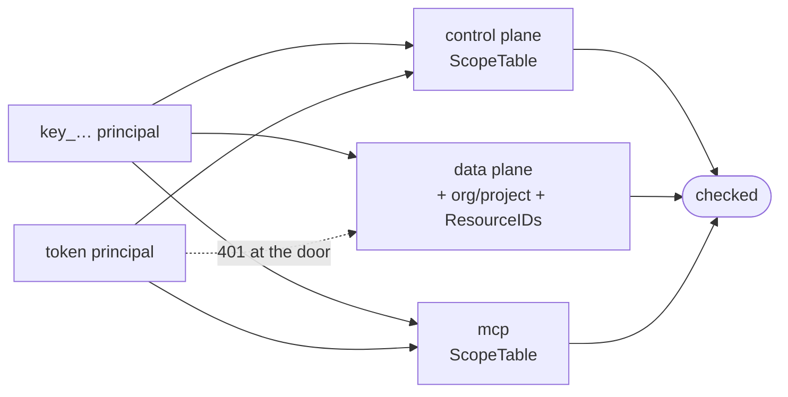

# Scopes

Wire contract. Keys store these exact strings; integrators type them; MCP hosts read them from
the metadata document. **Additive only** — renaming one invalidates keys in the field.

Defined in `internal/platform/authn/scope.go`, one `catalog` row per scope with its level.
`authn.Mintable()` gates minting; `authn.Valid()` still accepts a retired scope on an existing key.

## Catalog

| Scope           | Level   | Grants                                                                                                 |
| --------------- | ------- | ------------------------------------------------------------------------------------------------------ |
| `yasaku:read`   | project | Read ledger settings, wallets, categories, transactions, periods and reports; list projects; `Now`     |
| `yasaku:write`  | project | Create, update, archive and delete them; close and reopen periods; link, sync and unlink Google Sheets |
| `apikeys:read`  | project | List keys; `Whoami`                                                                                    |
| `apikeys:write` | project | **Retired.** Validates, grants nothing                                                                 |
| `members:read`  | org     | List the org's members (`member_list`)                                                                 |

- **Levels.** A `project` scope acts on data inside the projects a key reaches. An `org` scope acts
  on the org itself. A project key refuses an org scope (`APK003`); an org key or a personal token
  may hold one.
- **A key holds at most what its minter holds.** At mint every scope must admit a permission the
  minter holds; `apikeys:read` needs `apikeys:write`, and `members:read` is open to every member
  (`APK013` otherwise). A key works while its creator is a member; a demotion narrows it at its next
  call, and leaving the org stops it.
- **Who manages keys.** Org and project keys: a person holding `apikeys:write`, a console-only
  permission. A personal token: its owner, a member of its org. A key never manages keys.
- **Scopes admit permissions.** Every service method calls `authz.Can` against the held set the
  scope seam resolved once per request (`internal/platform/authz`). A session holds its role's
  permissions; a token holds role ∩ the permissions its scopes admit; a key holds its creator's
  current role ∩ its scopes, and a key with no recorded creator holds admin minus `members:write`,
  `roles:write` and `apikeys:write`. A token or key never holds a console permission.
- **Every new key expires** within `apikey.MaxLifetime` (a year).
- **Write admits reads inside the services.** `yasaku:write` admits the read permissions as well as
  the writes, so a write call that reads (resolving a wallet by name) works with a write-only
  credential. A read procedure or tool still asks for `yasaku:read` at the surface.
- **Project discovery rides on `yasaku:read`.** `project_list` and `ListProjects` need no
  `projects:read` of their own: a new scope string obliges every operator to extend the
  authorization server's catalog and re-attach the client before project discovery works at all.
- **Fine scopes are not live.** `internal/controlplane/scopes_yasaku.go` and
  `internal/mcp/scopes_yasaku.go` name per-domain scopes (`wallets:read`, `transactions:write` and
  others) in tables that nothing enforces yet. They are not in the catalog, so no key can hold them.

## Enforcement

| Surface       | Enforced by                             | Applies to                 |
| ------------- | --------------------------------------- | -------------------------- |
| control plane | `authn.Interceptor` + `ScopeTable()`    | keys and tokens            |
| data plane    | `apikey.Authorize` per route            | keys only — a token is 401 |
| mcp           | `mcp.Server.authorize` + `ScopeTable()` | keys and tokens            |
| console       | session membership and role             | —                          |

- **No credential is exempt.** A token is a delegated grant a client holds for a person, so its
  scopes are the limit of that delegation, on the control plane and on MCP alike. Only a console
  session skips the table, and the console never calls `/api/`. A procedure missing from the table
  is **denied**, not admitted; `TestEveryRPCHasAScope` pins it.
- **Challenges on Connect.** A 401 carries `WWW-Authenticate: Bearer resource_metadata="…/api"`
  and a scope denial adds `error="insufficient_scope", scope="<scope>"` (RFC 6750 Section 3).
- **MCP step-up.** An OAuth token missing a tool's scope gets an RFC 6750 `insufficient_scope`
  403 naming it. See [`mcp`](../mcp/README.md).
- **Key management stays in the console.** `apikeys:write` is retired, so no key can hold it; do
  not register it on the Othra resource server either. `APIKeyService.Create`/`Revoke` are
  `authn.SessionOnly` in the scope table: every key and token gets `PermissionDenied` with no
  `insufficient_scope` challenge.

Every surface narrows past the scope with one rule, `session.Principal.Reaches*`: a key reaches
only the projects it was granted — one for a project key, the grant for an org key or personal
token — and a non-empty `ResourceIDs` confines it to named resources.

## Adding one

A new string starts in two places, both of them here:

1. Constant + `catalog` entry, with its level, in `internal/platform/authn/scope.go`.
2. A row in the catalog above.

Mapping it onto a surface is that surface's own procedure:
[`howto/internal-api.md`](../howto/internal-api.md) for `internal/controlplane/scopes.go`,
[`howto/external-api.md`](../howto/external-api.md) for the `authorize` calls in
`internal/dataplane/`, [`howto/mcp-tool.md`](../howto/mcp-tool.md) for `internal/mcp/scopes.go`.

Never remove a scope — mark it `retired` instead. Keys holding it keep validating and it is never
minted again.
